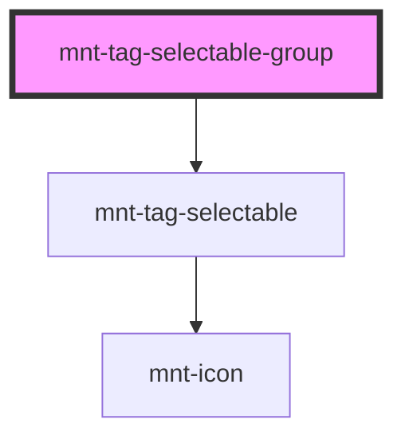

# mnt-tag-selectable-group

<!-- Auto Generated Below -->

## Properties

| Property            | Attribute      | Description | Type                                       | Default     |
| ------------------- | -------------- | ----------- | ------------------------------------------ | ----------- |
| `fullWidth`         | `full-width`   |             | `boolean`                                  | `false`     |
| `mode`              | `mode`         |             | `"multiple" \| "single"`                   | `'single'`  |
| `selectedId`        | `selected-id`  |             | `string`                                   | `undefined` |
| `selectedIds`       | `selected-ids` |             | `string`                                   | `undefined` |
| `size`              | `size`         |             | `"large" \| "medium" \| "small" \| "tiny"` | `'medium'`  |
| `tags` _(required)_ | --             |             | `TagItem[]`                                | `undefined` |

## Events

| Event            | Description | Type                               |
| ---------------- | ----------- | ---------------------------------- |
| `selectedChange` |             | `CustomEvent<TagGroupChangeEvent>` |

## Shadow Parts

| Part      | Description |
| --------- | ----------- |
| `"group"` |             |

## Dependencies

### Depends on

- [mnt-tag-selectable](../tag)

### Graph

----------------------------------------------

*Built with [StencilJS](https://stenciljs.com/)*
